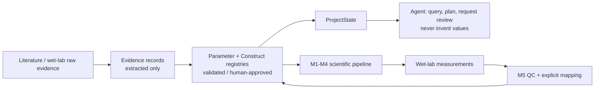

# Scientific-model contract

The boundary is intentional: retrieval and extraction create evidence or
`extracted` candidates; only human approval can make a literature/wet-lab
record eligible for real M3/M4 calculation. Conflicting values remain visible
in the registry and make a model input unresolved.

## Implemented

- M1 computes explicit linker features and negative-screen flags. It does not predict LLPS probability.
- M2 reports supplied SASA/RMSD/clash/confidence metrics and project-heuristic thresholds. Missing metrics produce `insufficient_data`.
- M3 calculates independent species concentrations from explicit `phi`, total concentration, and partition coefficient using mass conservation.
- M4 simulates PT `9 -> 10`, OC `10 -> 11`, and competitive DMT `9 -> 13` / `11 -> 15`, with per-enzyme abundance, partitioning, dense/dilute activity, and segmented gates.
- M5 accepts structured wet-lab records, flags rather than removes outliers, fits one apparent scale parameter, and gives deterministic diagnosis/recommendation primitives. Explicit scalar-field mappings can produce `validated` wet-lab candidates, never automatically approved parameters.

## Experimental inputs required for real mode

`phi`, each species Kp and abundance, kinetic constants, phase-specific residual activities, gate conditions, and their approved `ParameterRecord` provenance must be supplied. A literature evidence sentence is not itself a reviewed parameter. Assumptions are blocked unless `execution.allow_assumptions: true` is explicit.

## Optional

Structure predictors, FreeSASA, Vina, CALVADOS, and FTH1 geometry tools can supply bounded evidence. Their outputs are not proof of LLPS or catalytic activity. Vina is used only to flag a potentially disrupted binding pose.

## Planned / intentionally not implemented

No PDE, ER/lipid-droplet biophysics, Bayesian experiment design, or automatic conversion of external prediction output to biology is claimed. The current M5 fitter is intentionally restricted to one identifiable apparent parameter per call; fitting a full pathway requires sufficient time-course data and a separately specified fit plan.
