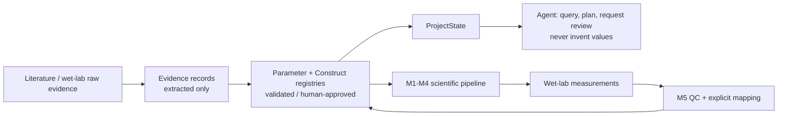

# Scientific-model contract

The boundary is intentional: retrieval and extraction create evidence or
`extracted` candidates; only human approval can make a literature/wet-lab
record eligible for real M3/M4 calculation. Conflicting values remain visible
in the registry and make a model input unresolved.

Parameter requirements declare a dimension and canonical unit: concentrations
are normalized to `uM`, kinetic rates to `1/h`, and `phi`/Kp/activity ratios are
dimensionless. Exact enzyme/substrate/product and stated compatible conditions
are required for real-model resolution. A value with a mismatched unit,
identity, host, mutant, or unsupported condition is unresolved rather than
silently converted or selected.

## Implemented

- M1 computes explicit linker features and negative-screen flags. It does not predict LLPS probability.
- M2 reports supplied SASA/RMSD/clash/confidence metrics and project-heuristic thresholds. Missing metrics produce `insufficient_data`.
- M3 calculates independent species concentrations from explicit `phi`, total concentration, and partition coefficient using mass conservation.
- M4 uses hours for its simulation and gate axis, writes a machine-readable trajectory artifact (`time`, `x9`, `x10`, `x11`, `x13`, `x15`), and requires explicit initial state/gates in real mode.
- M5 matches a prediction by `(construct_id, condition_id)`, interpolates the M4 `x15` trajectory to observed time points, and only runs a one-parameter fit with at least two aligned points. Endpoint-only data are labelled as such and are not treated as a trajectory fit.
- Validated wet-lab parameter candidates require an explicit human approval action before `approve_and_persist_parameter` appends an approved, provenance-bearing record to project YAML. Agent replanning after that external action is explicit, not autonomous.

## Experimental inputs required for real mode

`phi`, each species Kp and abundance, kinetic constants, phase-specific residual activities, gate conditions, and their approved `ParameterRecord` provenance must be supplied. A literature evidence sentence is not itself a reviewed parameter. Assumptions are blocked unless `execution.allow_assumptions: true` is explicit.

## Optional

Structure predictors, FreeSASA, Vina, CALVADOS, and FTH1 geometry tools can supply bounded evidence. Their outputs are not proof of LLPS or catalytic activity. Vina is used only to flag a potentially disrupted binding pose.

## Planned / intentionally not implemented

No PDE, ER/lipid-droplet biophysics, Bayesian experiment design, or automatic conversion of external prediction output to biology is claimed. The current M5 fitter is intentionally restricted to one identifiable apparent parameter per call; fitting a full pathway requires sufficient time-course data and a separately specified fit plan.
